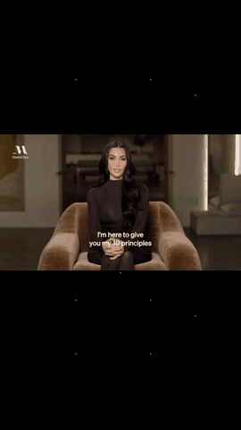
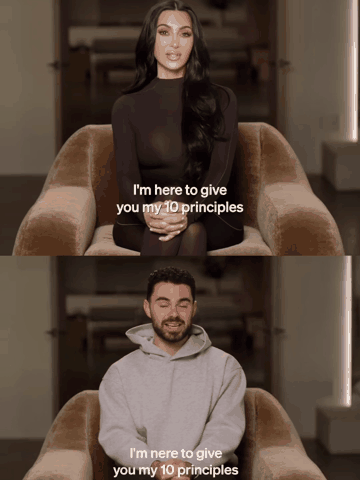
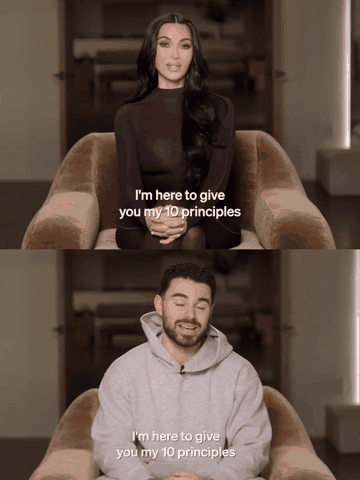

<p align="center">
  <a href="https://tein.ai"></a>
</p>
<p align="center"><a href="https://tein.ai"><strong>Join TEIN AI →</strong></a></p>

<p align="center">
  <a href="examples/advanced-black-nodes-v8-audio.mp4"></a>
  <a href="examples/1006%20%281%29.mp4"></a>
  <a href="examples/1006%20%281%29%283%29.mp4"></a>
</p>
<p align="center"><em>Click any preview to open its full video with audio.</em></p>

<h1 align="center">Genjustsu — Open Source Workflow</h1>
<p align="center"><strong>Your scene. New characters.</strong></p>
<p align="center">
  <a href="https://tein.ai"><strong>Join TEIN AI</strong></a> ·
  <a href="https://enhancor.ai"><strong>Get the Seedance API</strong></a> ·
  <a href="docs/SETUP-AGENT.md">Agent setup</a> ·
  <a href="examples/README.md">Examples</a> ·
  <a href="LICENSE">MIT license</a>
</p>

A local UI and agent-assisted pipeline for replacing video subjects using Depth-Anything-V2, local/cloud SAM 3 segmentation tracking, and Enhancor Seedance generation. The pipeline composites character depth maps strictly over the **original video background**, pitches isolated vocals **+3 semitones** for lip-sync and character animation guidance, and restores the entire original soundtrack in the final render.

---

## Table of Contents
1. [Key Features](#key-features)
2. [Prerequisites](#prerequisites)
3. [Installation](#installation)
4. [Configuration (.env)](#configuration-env)
5. [Running the Application](#running-the-application)
   - [Option A: Web Interface](#option-a-web-interface-recommended)
   - [Option B: Command Line (CLI)](#option-b-command-line-cli)
6. [Pipeline Walkthrough](#pipeline-walkthrough)
7. [Diagnostics & Recovery](#diagnostics--recovery)
8. [License & Credits](#license--credits)

---

## Key Features

- **Local SAM 3 Video Tracking:** GPU-accelerated video tracking with chunked memory management (250-frame segments) that prevents VRAM OOM on long clips.
- **Background Preservation Compositing:** Depth-Anything-V2 is composited strictly onto the segmented character silhouettes, preserving the original scene, background, lighting, and camera motion.
- **Vocal Isolation & Pitch Shift:** Separates vocals via Demucs, pitches them +3 semitones with Rubber Band CLI (preserving exact duration), and embeds them into `seedance-input.mp4`.
- **Full Soundtrack Restoration:** After Seedance generates new characters, the original soundtrack is restored byte-for-byte.
- **Multiple Pipeline Modes:**
  - **Advanced (Depth + SAM 3):** Full colored depth map composited over original background.
  - **Fast · Face Mesh:** Google MediaPipe Face Landmarker for head/face replacement without depth or SAM.
  - **Combined (Depth + Mesh):** Depth composite overlaid with facial motion tracking points.

---

## Prerequisites

### Operating System
- **Windows:** Windows 10/11 using **WSL2** (Ubuntu 22.04 or 24.04 recommended).
- **Linux:** Ubuntu 22.04+ / Debian 12+.
- **macOS:** macOS 12+ (Apple Silicon or Intel).

### System Tools
- **Python 3.12+** (`python3`, `python3-venv`)
- **FFmpeg** (`ffmpeg`)
- **Rubber Band CLI** (`rubberband` or `rubberband-cli`)
- **Cloudflared** (Required for the callback tunnel unless providing your own webhook)
- **NVIDIA GPU & CUDA** (Optional, recommended for local SAM 3 tracking; 8GB+ VRAM)

---

## Installation

### 1. Install System Dependencies

#### On Ubuntu / Debian / WSL2:
```bash
sudo apt update
sudo apt install -y python3 python3-venv python3-pip ffmpeg rubberband-cli git curl
```

#### On macOS (Homebrew):
```bash
brew update
brew install python@3.12 ffmpeg rubberband cloudflared
```

#### Install Cloudflared (if not already installed on Linux/WSL):
```bash
curl -fsSL https://pkg.cloudflare.com/cloudflare-main.gpg | sudo tee /usr/share/keyrings/cloudflare-main.gpg >/dev/null
echo "deb [signed-by=/usr/share/keyrings/cloudflare-main.gpg] https://pkg.cloudflare.com/cloudflared $(lsb_release -cs) main" | sudo tee /etc/apt/sources.list.d/cloudflared.list
sudo apt update && sudo apt install -y cloudflared
```

---

### 2. Set Up Python Virtual Environment

Clone or navigate to the repository directory:
```bash
cd Genjustsu-Open-Source-Workflow-main
```

Create and activate the virtual environment:
```bash
python3 -m venv .venv
source .venv/bin/activate
```

Upgrade pip and install dependencies:
```bash
pip install --upgrade pip setuptools wheel
pip install -r requirements.txt
```

---

### 3. Local SAM 3 Setup (Optional — for Local GPU Tracking)

The repository includes SAM 3 in `sam3/` for local person silhouette tracking.
Install PyTorch with CUDA support inside `.venv`:
```bash
pip install torch torchvision --index-url https://download.pytorch.org/whl/cu121
pip install timm huggingface_hub
```

> **Note on Weights:** The official Hugging Face `facebook/sam3` repository requires an authenticated token. This repository is pre-configured to use the community mirror (`bodhicitta/sam3`), which downloads `sam3.pt` automatically on first run without requiring a Hugging Face login.

---

### 4. Optional Face Mesh Setup

If you plan to use **Fast · Face Mesh** or **Combined · Depth + Face Mesh**:
```bash
bash setup-face-mesh.sh
```

---

## Configuration (.env)

Copy `.env.example` to `.env`:
```bash
cp .env.example .env
```

Open `.env` in your text editor and supply your API keys:
```env
# Required for Seedance video generation:
ENHANCOR_API_KEY=your_enhancor_api_key_here

# Required if using cloud Replicate models (Demucs vocal isolation, cloud SAM fallback, cloud Depth):
REPLICATE_API_TOKEN=your_replicate_token_here

# Optional: Port configuration (default 8770)
PORT=8770

# Optional: Media Hosting (default: tmpfiles with catbox fallback)
MEDIA_HOST=tmpfiles
MEDIA_HOST_FALLBACKS=catbox
```

- **Get Enhancor Key:** [app.enhancor.ai/api-dashboard](https://app.enhancor.ai/api-dashboard)
- **Get Replicate Token:** [replicate.com/account/api-tokens](https://replicate.com/account/api-tokens)

---

## Running the Application

### Option A: Web Interface (Recommended)

Start the local server and Cloudflare Quick Tunnel with a single command:
```bash
./start.command
# Or alternatively:
bash start.command
```

Once started:
1. Open your browser to **[http://127.0.0.1:8770](http://127.0.0.1:8770)**.
2. Upload your source video (`.mp4` or `.mov`).
3. Select your desired mode (**Advanced Depth**, **Face Mesh**, or **Combined**).
4. Click **Prepare Video**. The system will:
   - Extract and pitch vocals (+3 semitones).
   - Generate Depth-Anything-V2 maps.
   - Run local SAM 3 segmentation to isolate the character silhouette.
   - Composite the depth map over the original background.
5. Review the resulting mask and composited video preview.
6. Provide character reference images or prompt, and click **Create Draft**.
7. Once satisfied with the draft preview, click **Approve 1080p** to render final HD output.

---

### Option B: Command Line (CLI)

You can also run stages directly from the command line:

#### 1. Check Installation Health
```bash
.venv/bin/python doctor.py --require-keys
```

#### 2. Run Video Preparation
```bash
.venv/bin/python workflow.py prepare path/to/video.mp4 --mode depth
```

#### 3. Run Standalone SAM 3 Segmentation
To generate character silhouette masks for any video:
```bash
.venv/bin/python segment_sam3.py path/to/video.mp4 output_masks/ person
```

#### 4. Resume an Existing Job
```bash
.venv/bin/python workflow.py status <LOCAL_JOB_ID>
.venv/bin/python workflow.py resume <LOCAL_JOB_ID>
.venv/bin/python workflow.py resume <LOCAL_JOB_ID> --hd
```

---

## Pipeline Walkthrough

```
Input Video (original.mp4)
      │
      ├──> [Demucs] ──────> Isolated Vocals ──> [Rubber Band (+3)] ──> Pitched Vocals
      │                                                                       │
      ├──> [Depth-Anything-V2] ──> Depth Map (depth.mp4)                      │
      │                                    │                                  │
      └──> [SAM 3 (Chunked)] ────> Silhouette Mask (mask.mp4)                 │
                                           │                                  │
                                           ▼                                  ▼
                        [Composite: Depth over Background] ──> [seedance-input.mp4]
                                                                      │
                                                           [Enhancor Seedance]
                                                                      │
                                                           [Audio Restoration]
                                                                      ▼
                                                              Final 1080p Video
```

1. **Source Video:** The uploaded clip is normalized to 24 fps.
2. **Audio Extraction:** Audio is split using Demucs. Vocals are pitched **+3 semitones** without altering duration, providing clear lip-sync cues.
3. **Depth Generation:** Depth-Anything-V2 computes depth geometry while preserving relative distances.
4. **SAM 3 Tracking:** SAM 3 tracks the subject across 250-frame chunks, ensuring constant high throughput (~2.5 fps) and memory safety on 8GB-12GB GPUs.
5. **Compositing:** The character silhouette receives the depth map, while the original background remains completely intact.
6. **Seedance & Master Render:** Enhancor Seedance replaces the character based on prompts/references. The original master audio is remuxed onto the final video.

---

## Diagnostics & Recovery

| Script / Command | Purpose |
| :--- | :--- |
| `.venv/bin/python doctor.py` | Verify installed binaries, Python packages, and model accessibility |
| `.venv/bin/python doctor.py --require-keys` | Verify `.env` API keys and balance availability |
| `.venv/bin/python test_composite.py` | Verify local OpenCV compositing functionality |
| `.venv/bin/python -m unittest discover -s tests` | Run automated test suite |

---

## License & Credits

- **Code & Documentation:** [MIT License](LICENSE) © 2026 Sirio Berati.
- **SAM 3:** Meta AI Research.
- **Depth Anything:** TikTok / ByteDance & HKUST.
- **MediaPipe:** Google LLC.
- **Enhancor Seedance:** [Enhancor.ai](https://enhancor.ai).
